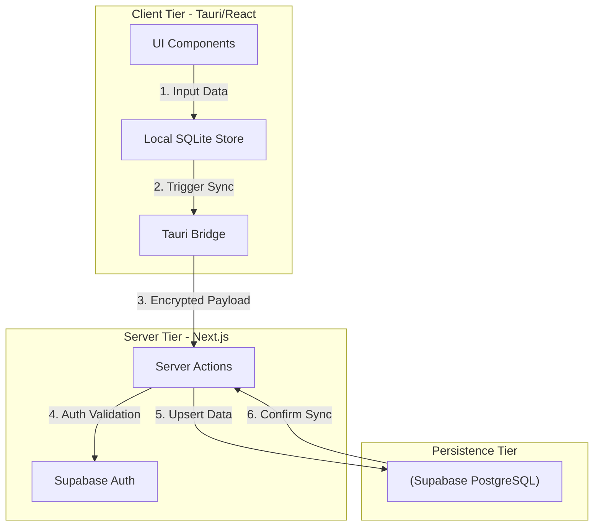
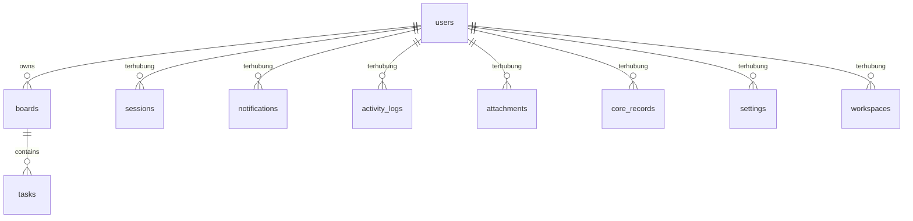

# PRD — Nexus Desktop Command Center

## 1. Overview

### 1.1 Problem Statement & Konteks Lapangan
Freelance developer dan mahasiswa sering mengalami fragmentasi kognitif akibat penggunaan aplikasi terpisah untuk manajemen tugas kuliah, klien, dan keuangan. Ketidakterhubungan data ini menyebabkan inefisiensi operasional, keterlambatan penyelesaian Maintenance Tracker, dan kesulitan dalam memantau kesehatan finansial secara real-time.

### 1.2 Hipotesis Solusi & Alur Kunci
Dengan menyediakan Nexus Desktop Command Center yang mengintegrasikan Kanban Board, Maintenance Tracker, dan pelacakan keuangan dalam satu App Shell berbasis lokal, pengguna akan mengalami peningkatan efisiensi manajemen waktu sebesar 40 persen dan penurunan beban kognitif.

### 1.3 Keunggulan Strategis & Keselarasan Solusi
Produk ini memposisikan diri sebagai sistem operasi personal yang mengutamakan privasi melalui penyimpanan SQLite lokal dengan sinkronisasi cloud, selaras dengan kebutuhan target persona yang memerlukan kontrol penuh atas data operasional mereka.

### 1.4 Target Persona & Pengguna Sistem
Freelance Developer & Mahasiswa

### 1.5 Target Metrik & KPI Produksi
- **Metrik Operasional / Online**: Monitoring real-time melalui Supabase Dashboard untuk memantau latensi API dan error rate pada endpoint sinkronisasi. | SLO Teknis: Latensi p95 untuk interaksi UI di bawah 100ms; Tingkat keberhasilan sinkronisasi data SQLite ke Supabase sebesar 99.9 persen; Waktu muat App Shell kurang dari 2 detik pada perangkat dengan RAM 8GB
- **Validasi Fungsional / Golden Set**: Aplikasi harus mampu melakukan operasi CRUD penuh pada SQLite lokal tanpa koneksi internet dan melakukan antrean sinkronisasi otomatis saat koneksi pulih.

## 2. Requirements

### Persyaratan Fungsional

- Pengguna dapat mengelola autentikasi multi-user berbasis Supabase Auth.
- Pengguna dapat mengelola enkripsi AES-256 untuk database SQLite lokal.
- Pengguna dapat mengelola implementasi App Shell dengan navigasi sidebar.
- Pengguna dapat mengelola modul Kanban Board untuk manajemen tugas.
- Pengguna dapat mengelola modul Maintenance Tracker untuk status aplikasi.
- Pengguna dapat mengelola modul pelacakan arus kas masuk dan keluar.
- Pengguna dapat mengelola sinkronisasi data latar belakang ke Supabase.
- Pengguna dapat mengelola integrasi asisten AI untuk ringkasan tugas.
- Pengguna dapat mengelola dashboard ringkasan operasional harian.
- Sistem backup dan restore data lokal.
- Pengguna dapat mengelola [Termasuk dalam MVP] Pengguna memiliki koneksi internet stabil untuk sinkronisasi cloud berkala.
- Pengguna dapat mengelola [Termasuk dalam MVP] Perangkat pengguna memiliki spesifikasi minimum untuk menjalankan runtime Tauri.
- Pengguna dapat mengelola [Termasuk dalam MVP] Data keuangan yang diinput bersifat manual dan tidak memerlukan integrasi API perbankan.

### Persyaratan Non-Fungsional

- Antarmuka sederhana dan ramah untuk Freelance Developer & Mahasiswa (navigasi intuitif, alur ringkas, istilah mudah dipahami).
- Responsif: nyaman dan optimal dipakai di perangkat mobile/HP, tablet, maupun laptop/desktop untuk menunjang fleksibilitas Freelance Developer & Mahasiswa.
- Keamanan Data: data nexus desktop command center terisolasi dan hanya bisa diakses oleh akun terautentikasi sesuai hak akses (terproteksi sesi login aman).
- Penyimpanan Aman: berkas dokumen, lampiran, dan data operasional tersimpan aman secara persisten serta dapat diakses kembali.
- Integritas Riwayat: riwayat pencatatan dan aktivitas tidak hilang (didukung mekanisme soft-delete dan jejak audit) untuk akuntabilitas data.
- Proses simpan dan pemuatan data terasa cepat (< 2 detik) agar tidak mengganggu aktivitas harian pengguna.
- Keandalan Layanan AI: integrasi transkripsi/inferensi AI dilengkapi penanganan timeout otomatis, penanganan batas kuota, dan indikator status progres yang transparan.
- Mitigasi operasional: Fitur untuk menonaktifkan sinkronisasi cloud secara instan dan beralih ke mode lokal penuh jika terjadi kebocoran data.. Mitigasi Layanan: Sistem akan menyimpan antrean perubahan dalam local queue jika Supabase tidak merespons dan melakukan retry dengan exponential backoff.. Kebijakan Retensi: Data lokal disimpan permanen, sedangkan data cloud akan dihapus secara otomatis jika akun tidak aktif selama 12 bulan.

### Asumsi & Batasan

- Skala Pengguna: Dirancang untuk Freelance Developer & Mahasiswa dengan kapasitas data terkelola.
- Batasan Akses: Satu akun pengguna terhubung ke profil/ruang kerja utama pada rilis awal.
- Bahasa Antarmuka: Bahasa Indonesia profesional dengan istilah rekayasa perangkat lunak modern.
- [Termasuk dalam MVP] Pengguna memiliki koneksi internet stabil untuk sinkronisasi cloud berkala
- [Termasuk dalam MVP] Perangkat pengguna memiliki spesifikasi minimum untuk menjalankan runtime Tauri
- [Termasuk dalam MVP] Data keuangan yang diinput bersifat manual dan tidak memerlukan integrasi API perbankan
- [Di Luar Cakupan / Tahap Berikutnya] Tidak ada dukungan untuk sinkronisasi multi-perangkat secara simultan karena risiko konflik data SQLite
- [Di Luar Cakupan / Tahap Berikutnya] Tidak ada fitur enkripsi end-to-end untuk data di cloud guna mempermudah pemrosesan AI
- [Di Luar Cakupan / Tahap Berikutnya] Tidak ada dukungan untuk perangkat mobile karena fokus pada produktivitas desktop

## 3. Core Features

Fitur di bawah ini disusun mengikuti urutan fase pada kerangka fitur yang sudah disetujui.

### Fase 1 — Fondasi: Fondasi App Shell & Autentikasi

Fondasi App Shell & Autentikasi — perlindungan akses, tata kelola wewenang peran staf, dan pencatatan audit.

- **Sistem Login Multi-User Lokal** — Membatasi hak akses menu dan aksi pengguna sesuai dengan tanggung jawab masing-masing.
- **Enkripsi Data SQLite Lokal** — Memfasilitasi eksekusi alur teknis enkripsi data sqlite lokal dengan validasi data terstruktur.
- **Manajemen Sesi Desktop** — Memfasilitasi eksekusi alur teknis manajemen sesi desktop dengan validasi data terstruktur.
- **Sinkronisasi Profil Cloud** — Memfasilitasi eksekusi alur teknis sinkronisasi profil cloud dengan validasi data terstruktur.

### Fase 2 — Pencatatan Harian & Katalog: Manajemen Tugas & Proyek

Manajemen Tugas & Proyek — antarmuka terintegrasi untuk menjalankan fungsionalitas manajemen tugas & proyek secara terstruktur.

- **Kanban Board Proyek Klien** — Memfasilitasi eksekusi alur teknis kanban board proyek klien dengan validasi data terstruktur.
- **Task Tracker Tugas Kuliah** — Memfasilitasi eksekusi alur teknis task tracker tugas kuliah dengan validasi data terstruktur.
- **Timeline Maintenance Aplikasi** — Memfasilitasi eksekusi alur teknis timeline maintenance aplikasi dengan validasi data terstruktur.
- **Prioritas Tugas Otomatis** — Memfasilitasi eksekusi alur teknis prioritas tugas otomatis dengan validasi data terstruktur.

### Fase 3 — Akurasi & Pelaporan: Manajemen Keuangan Terpadu

Manajemen Keuangan Terpadu — antarmuka terintegrasi untuk menjalankan fungsionalitas manajemen keuangan terpadu secara terstruktur.

- **Pencatatan Pengeluaran Maintenance** — Mencatat transaksi entri baru dengan validasi instan agar data bertambah secara akurat.
- **Laporan Arus Kas Bulanan** — Menyusun rekapitulasi data periodik dan berkas siap unduh untuk arsip dan pembukuan.
- **Kategorisasi Biaya Operasional** — Memasukkan kuantitas unit beserta parameter harga dan perhitungan otomatis.
- **Dashboard Anggaran Proyek** — Memfasilitasi eksekusi alur teknis dashboard anggaran proyek dengan validasi data terstruktur.

### Fase 4 — Akun & Keamanan: Asisten Cerdas Gemini 3.8

Asisten Cerdas Gemini 3.8 — antarmuka terintegrasi untuk menjalankan fungsionalitas asisten cerdas gemini 3.8 secara terstruktur.

- **Analisis Konteks Tugas Kuliah** — Memfasilitasi eksekusi alur teknis analisis konteks tugas kuliah dengan validasi data terstruktur.
- **Otomasi Balasan Pesan Klien** — Memfasilitasi eksekusi alur teknis otomasi balasan pesan klien dengan validasi data terstruktur.
- **Ringkasan Proyek Berbasis AI** — Menampilkan jumlah jenis data dan ringkasan metrik utama dalam angka besar yang mudah dibaca.
- **Smart Query Data Keuangan** — Memfasilitasi eksekusi alur teknis smart query data keuangan dengan validasi data terstruktur.

### Fase 5 — Pengembangan Lanjutan: Integrasi Eksternal & Komunikasi

Integrasi Eksternal & Komunikasi — antarmuka terintegrasi untuk menjalankan fungsionalitas integrasi eksternal & komunikasi secara terstruktur.

- **Google Workspace Sync** — Memfasilitasi eksekusi alur teknis google workspace sync dengan validasi data terstruktur.
- **Gateway WhatsApp API** — Memfasilitasi eksekusi alur teknis gateway whatsapp api dengan validasi data terstruktur.
- **Bot Notifikasi Telegram** — Memfasilitasi eksekusi alur teknis bot notifikasi telegram dengan validasi data terstruktur.
- **Local Message Queue untuk API** — Memfasilitasi eksekusi alur teknis local message queue untuk api dengan validasi data terstruktur.

### Fase 6 — Pengembangan Lanjutan: Analitik & Laporan Operasional

Analitik & Laporan Operasional — menyajikan rekapitulasi performa bisnis dan cetak berkas laporan siap pakai.

- **Dashboard Performa Maintenance** — Memfasilitasi eksekusi alur teknis dashboard performa maintenance dengan validasi data terstruktur.
- **Visualisasi Data Keuangan** — Memfasilitasi eksekusi alur teknis visualisasi data keuangan dengan validasi data terstruktur.
- **Export Laporan Kinerja Klien** — Menyusun rekapitulasi data periodik dan berkas siap unduh untuk arsip dan pembukuan.
- **Audit Log Aktivitas Sistem** — Merekam riwayat perubahan dan aktivitas operasional untuk menjaga akuntabilitas kerja.

## 4. User Flow

Alur utama yang akan dilalui pengguna, disusun mengikuti urutan fase:

1. **Daftar & Masuk (FASE 1 – tersedia lebih awal sebagai pondasi akses)**: Pengguna (Freelance Developer & Mahasiswa) membuat akun, lalu login ke dalam sistem. Setelah berhasil masuk, pengguna melengkapi konfigurasi profil awal dan preferensi kerja pada Nexus Desktop Command Center.

2. **Fondasi App Shell & Autentikasi (FASE 1)**: Pengguna membuka halaman **Fondasi App Shell & Autentikasi** untuk mengelola fitur **Sistem Login Multi-User Lokal** dan **Enkripsi Data SQLite Lokal**. Pengguna memasukkan parameter yang dibutuhkan, lalu sistem memvalidasi kelengkapan data dan memperbarui status secara realtime.

3. **Manajemen Tugas & Proyek (FASE 2 – first win)**: Pengguna membuka halaman **Manajemen Tugas & Proyek** untuk mengelola fitur **Kanban Board Proyek Klien** dan **Task Tracker Tugas Kuliah**. Pengguna memasukkan parameter yang dibutuhkan, lalu sistem memvalidasi kelengkapan data dan memperbarui status secara realtime.

4. **Manajemen Keuangan Terpadu (FASE 2)**: Pengguna membuka halaman **Manajemen Keuangan Terpadu** untuk mengelola fitur **Pencatatan Pengeluaran Maintenance** dan **Laporan Arus Kas Bulanan**. Pengguna memasukkan parameter yang dibutuhkan, lalu sistem memvalidasi kelengkapan data dan memperbarui status secara realtime.

5. **Asisten Cerdas Gemini 3.8 (FASE 3)**: Pengguna membuka halaman **Asisten Cerdas Gemini 3.8** untuk mengelola fitur **Analisis Konteks Tugas Kuliah** dan **Otomasi Balasan Pesan Klien**. Pengguna memasukkan parameter yang dibutuhkan, lalu sistem memvalidasi kelengkapan data dan memperbarui status secara realtime.

6. **Integrasi Eksternal & Komunikasi (FASE 3)**: Pengguna membuka halaman **Integrasi Eksternal & Komunikasi** untuk mengelola fitur **Google Workspace Sync** dan **Gateway WhatsApp API**. Pengguna memasukkan parameter yang dibutuhkan, lalu sistem memvalidasi kelengkapan data dan memperbarui status secara realtime.

7. **Tinjau & Ekspor Analitik & Laporan Operasional (FASE 4)**: Pengguna membuka halaman **Analitik & Laporan Operasional** untuk mengelola fitur **Dashboard Performa Maintenance** dan **Visualisasi Data Keuangan**. Pengguna memasukkan parameter yang dibutuhkan, lalu sistem memvalidasi kelengkapan data dan memperbarui status secara realtime.

## 5. Architecture

Arsitektur sistem dirancang dengan prinsip pemisahan tanggung jawab (separation of concerns), keamanan tingkat produksi, dan pemetaan alur transaksi inti (critical path) yang jelas. Komponen di bawah memetakan bagaimana antarmuka pengguna, logika server, basis data, dan integrasi eksternal berinteraksi secara efisien.

### Gambaran sistem:

- **Tauri Core (Rust)**: Desktop Shell
- **Local Store (SQLite)**: Offline Persistence
- **Sync Engine (Next.js Server Actions)**: Data Synchronization
- **Cloud DB (Supabase PostgreSQL)**: Remote Persistence

### Diagram alur sistem:

## 6. Database Schema

Berikut tabel-tabel utama yang dibutuhkan. Nama kolom memakai huruf kecil dengan garis bawah.

### 1. users — data akun pengguna (dikelola sistem autentikasi / Supabase Auth)

| Kolom | Tipe | Kegunaan |
| :--- | :--- | :--- |
| `id` | `text` | ID unik akun |

### 2. sessions — sesi login aktif (dikelola sistem autentikasi)

| Kolom | Tipe | Kegunaan |
| :--- | :--- | :--- |
| `id` | `text` | ID unik sesi |
| `user_id` | `text` | Relasi ke users |
| `token` | `text` | Token sesi login unik |
| `expires_at` | `timestamp` | Waktu sesi kadaluarsa |
| `created_at` | `timestamp` | Waktu dibuat |

### 3. notifications — log notifikasi peringatan & pesan sistem

| Kolom | Tipe | Kegunaan |
| :--- | :--- | :--- |
| `id` | `text` | ID unik notifications |
| `user_id` | `text` | Relasi ke users |
| `name` | `text` | Judul notifikasi |
| `notes` | `text` | Isi pesan WhatsApp / notifikasi |
| `is_read` | `boolean` | Status apakah notifikasi sudah dibaca |
| `created_at` | `timestamp` | Waktu dikirim |

### 4. activity_logs — data activity logs

| Kolom | Tipe | Kegunaan |
| :--- | :--- | :--- |
| `id` | `text` | ID unik activity logs |
| `user_id` | `text` | Relasi ke users |
| `name` | `text` | Nama atau judul entitas activity_logs |
| `status` | `text` | Status operasional |
| `created_at` | `timestamp` | Waktu dibuat |

### 5. attachments — data attachments

| Kolom | Tipe | Kegunaan |
| :--- | :--- | :--- |
| `id` | `text` | ID unik attachments |
| `user_id` | `text` | Relasi ke users |
| `name` | `text` | Nama atau judul entitas attachments |
| `status` | `text` | Status operasional |
| `created_at` | `timestamp` | Waktu dibuat |

### 6. boards — data boards

| Kolom | Tipe | Kegunaan |
| :--- | :--- | :--- |
| `id` | `text` | ID unik boards |

### 7. core_records — data core records

| Kolom | Tipe | Kegunaan |
| :--- | :--- | :--- |
| `id` | `text` | ID unik core records |
| `user_id` | `text` | Relasi ke users |
| `name` | `text` | Nama atau judul entitas core_records |
| `status` | `text` | Status operasional |
| `created_at` | `timestamp` | Waktu dibuat |

### 8. settings — data settings

| Kolom | Tipe | Kegunaan |
| :--- | :--- | :--- |
| `id` | `text` | ID unik settings |
| `user_id` | `text` | Relasi ke users |
| `name` | `text` | Nama atau judul entitas settings |
| `status` | `text` | Status operasional |
| `created_at` | `timestamp` | Waktu dibuat |

### 9. tasks — data tasks

| Kolom | Tipe | Kegunaan |
| :--- | :--- | :--- |
| `id` | `text` | ID unik tasks |

### 10. workspaces — ruang kerja atau grup profil pengguna

| Kolom | Tipe | Kegunaan |
| :--- | :--- | :--- |
| `id` | `text` | ID unik workspaces |
| `user_id` | `text` | Relasi ke users |
| `name` | `text` | Nama atau judul entitas workspaces |
| `status` | `text` | Status operasional |
| `created_at` | `timestamp` | Waktu dibuat |

### Diagram hubungan antar tabel (ER):

## 7. Tech Stack

Karena pilihan teknologi diserahkan ke AI, berikut rekomendasi yang paling cocok untuk aplikasi nexus desktop command center skala kecil — sederhana, cepat dibangun, dan mudah dirawat.

- **Framework (Frontend + Backend):** React (Vite) + Tailwind — kerangka utama untuk membangun antarmuka dan backend terpadu.
- **UI & Styling:** Tailwind CSS + shadcn/ui — komponen siap pakai yang rapi, cepat, dan konsisten; cocok untuk tampilan dashboard dan tabel yang perlu enak dibaca.
- **Grafik:** Recharts — untuk grafik analitik dan visualisasi metrik utama pada dashboard.
- **ORM:** Drizzle ORM — ringan dan jelas, memudahkan pengelolaan skema serta query ke basis data.
- **Basis Data:** Supabase (PostgreSQL) — basis data relasional terkelola dengan Row Level Security (RLS) bawaan, integritas relasi foreign key, dan performa tinggi.
- **Autentikasi:** Better Auth — menangani daftar akun, login/logout, sesi, dan ganti kata sandi.
- **Ekspor Laporan:** ExcelJS untuk file Excel dan PDFKit (atau sejenis) untuk file PDF — dijalankan di sisi server.
- **Deployment:** Docker (VPS / Coolify) — containerization mandiri yang terisolasi, mudah direplikasi dengan Docker Compose, dan memberikan kontrol penuh atas lingkungan server.
- **Validasi Form:** Zod — memastikan data yang diisi pengguna valid sebelum disimpan.

Catatan: Aplikasi ini mengintegrasikan layanan AI melalui API LLM untuk otomatisasi dan pemrosesan cerdas.

